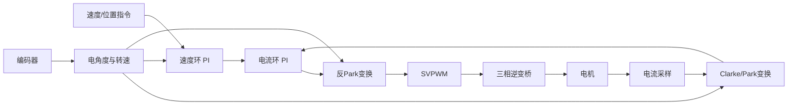

# FOC 磁场定向控制

## 概述

FOC（Field-Oriented Control，磁场定向控制），又称矢量控制（Vector Control），通过对定子三相电流进行坐标变换，将其分解为励磁分量（d 轴）与转矩分量（q 轴），实现磁场与转矩的解耦控制，使交流电机获得近似直流电机的调速性能。

**适用电机：**

| 电机类型 | 反电动势波形 | FOC 适配情况 |
| ---- | ---- | ---- |
| PMSM（永磁同步电机） | 正弦波 | 最佳匹配，矢量控制的标准对象 |
| BLDC（无刷直流电机） | 梯形波 | 可用方波六步换相，但 FOC 运行更安静、效率更高 |
| 感应电机（异步电机） | — | 需附加磁通观测/转差补偿，工业变频器主流方案 |

## 整体控制框架

核心闭环：**电流环（内环）→ 速度环 → 位置环（外环）**，电角度 $\theta_e$ 参与所有坐标变换，是整个系统的基准。

## 坐标变换与数学基础

### Clarke 变换（abc → αβ）

将三相静止坐标系变换到两相静止正交坐标系（等幅值变换，配合三相平衡 $i_a+i_b+i_c=0$）：

$$
\begin{bmatrix} i_\alpha \\ i_\beta \end{bmatrix} =
\frac{2}{3}\begin{bmatrix} 1 & -\tfrac{1}{2} & -\tfrac{1}{2} \\ 0 & \tfrac{\sqrt{3}}{2} & -\tfrac{\sqrt{3}}{2} \end{bmatrix}
\begin{bmatrix} i_a \\ i_b \\ i_c \end{bmatrix}
\quad\Longrightarrow\quad
i_\alpha = i_a,\quad i_\beta = \frac{i_a + 2i_b}{\sqrt{3}}
$$

> 若采用等功率变换（Concordia），系数为 $\sqrt{2/3}$，功率不变但幅值缩放不同，注意与控制器参数一致性。

### Park 变换（αβ → dq）

将静止坐标系旋转到与转子磁场同步旋转的 dq 坐标系（$\theta_e$ 为电角度）：

$$
\begin{bmatrix} i_d \\ i_q \end{bmatrix} =
\begin{bmatrix} \cos\theta_e & \sin\theta_e \\ -\sin\theta_e & \cos\theta_e \end{bmatrix}
\begin{bmatrix} i_\alpha \\ i_\beta \end{bmatrix}
$$

- **d 轴（直轴）**：与转子磁链对齐，对应励磁分量，PMSM 稳态运行通常令 $i_d^* = 0$
- **q 轴（交轴）**：与转子磁链正交，对应转矩分量，$T_e \propto i_q$

### 反 Park 变换（dq → αβ）

电压指令从旋转坐标系变换回静止坐标系，输出给 SVPWM：

$$
\begin{bmatrix} u_\alpha \\ u_\beta \end{bmatrix} =
\begin{bmatrix} \cos\theta_e & -\sin\theta_e \\ \sin\theta_e & \cos\theta_e \end{bmatrix}
\begin{bmatrix} u_d \\ u_q \end{bmatrix}
$$

### 电角度与机械角度

$$\theta_e = \theta_m \times p + \theta_{offset}$$

其中 $p$ 为极对数，$\theta_{offset}$ 为编码器零点偏移（见下文校准小节）。

## SVPWM 空间矢量调制

**目标**：用逆变器的 8 个开关状态（6 个有效矢量 + 2 个零矢量）合成逼近参考电压矢量 $U_{ref}$ 的输出。

实现步骤：

1. **扇区判断**：根据 $U_\alpha$、$U_\beta$ 与扇区边界条件计算所在 60° 扇区（N = 1~6）
2. **矢量作用时间**：用相邻两个有效矢量 + 零矢量按伏秒平衡合成，计算 $T_1$、$T_2$，并做饱和限幅（过调制保护）
3. **七段式 PWM**：将作用时间分配到三相比较寄存器，中心对齐模式输出对称波形，零矢量居中降低开关损耗

**关键结论**：

| 指标 | SPWM | SVPWM |
| ---- | ---- | ---- |
| 相电压幅值上限 | $U_{dc}/2$ | $U_{dc}/\sqrt{3} \approx 0.577\,U_{dc}$ |
| 直流母线电压利用率 | 基准 | 提升 **15.47%** |

## 控制环路结构

| 环路 | 典型带宽 | 采样/执行频率 | 职责 |
| ---- | ---- | ---- | ---- |
| 电流环 | 数百 Hz ~ 1 kHz+ | 与 PWM 同频（16~40 kHz） | 跟踪 $i_d^*$ / $i_q^*$，保证动态与限流安全 |
| 速度环 | 电流环的 1/5 ~ 1/10 | 1~10 kHz | 稳速输出，输出 $i_q^*$ |
| 位置环 | 速度环的 1/5 ~ 1/10 | 数十~数百 Hz | 定位/伺服跟踪 |

电流环 PI 输出（含 dq 交叉解耦前馈）：

$$
u_d = K_p(i_d^* - i_d) + K_i\!\int(i_d^* - i_d)\,dt - \omega_e L_q i_q
$$

$$
u_q = K_p(i_q^* - i_q) + K_i\!\int(i_q^* - i_q)\,dt + \omega_e (L_d i_d + \psi_f)
$$

> 带宽关系经验值：内环带宽 ≈ 开关频率的 1/10 ~ 1/20；外环逐级递减约 5~10 倍，保证环路间解耦。

## 位置/速度反馈方案

| 方案 | 分辨率/接口 | 特点 | 典型场景 |
| ---- | ---- | ---- | ---- |
| AS5600（磁编码器） | 12 位 / I2C | 便宜、免调试；I2C 带宽限制高动态性能 | SimpleFOC 入门标配 |
| MT6701（磁编码器） | 14 位 / I2C、ABZ、SPI | 接口灵活，性能/价格均衡 | 中端方案 |
| TLE5012（磁编码器） | SPI | 刷新快，适合高转速 | 高动态伺服 |
| 增量编码器（ABZ） | 高分辨率 / 正交解码 | 需定时器编码器模式计数，上电需寻零 | 工业伺服 |
| 霍尔传感器（3 个） | 60° 电角度 | 零成本附加，需插值平滑 | 风机/水泵等调速 |
| 无感（观测器） | — | 省传感器；零低速需高频注入，中高速用 SMO/反电动势 | 家电、无人机 |

## 电流采样方案

| 方案 | 说明 | 注意事项 |
| ---- | ---- | ---- |
| 低侧三电阻 | 下桥臂串采样电阻 + 运放放大，成本低，主流方案 | 必须与 PWM 同步：中心对齐模式下在计数器**下溢/溢出点**触发 ADC 注入采样，此刻下管全导通 |
| 在线单电阻 | 母线单电阻分时采样 | 依赖 PWM 扇区时序，算法复杂 |
| 霍尔传感器（ACS712 等） | 隔离、易用 | 带宽低、有噪声，适合大电流/低速场景 |
| 专用运放（INA240 等） | 增强 PWM 共模抑制 | 高精度场合推荐 |

## 硬件选型

### MCU / DSP

| 芯片 | 关键外设 | 说明 |
| ---- | ---- | ---- |
| STM32G431/G474 | 高级定时器、HRTIM、CORDIC/FMAC、ADC 注入同步 | ST 电机控制专用系列，主流之选 |
| STM32F1/F4 | 高级定时器 TIM1/TIM8 | 经典入门平台 |
| ESP32 / ESP32-S3 | MCPWM、双核 | SimpleFOC 社区常用 |
| TI C2000（F280049 等） | ePWM、CLA 浮点协处理器 | 工业级电机控制 DSP |

### 功率与驱动

| 器件 | 类型 | 说明 |
| ---- | ---- | ---- |
| DRV8301/8302 | 三相栅极驱动 + 集成电流采样运放 | ODrive v3 经典方案 |
| DRV8353 | 智能三相栅极驱动 | 高性能场合 |
| MP6540 | 集成三相功率级（驱动+MOS） | 接线最少，SimpleFOC 常用 |
| IR2104 / EG2133 | 半桥驱动 | 自搭分立三相桥，成本可控 |

MOSFET 选型要点：$V_{DS}$ 耐压 ≥ 2 倍母线电压（感性尖峰裕量）、低 $R_{DS(on)}$、关注封装热阻与母线电容纹波承受能力。

### 编码器

见上文 [位置/速度反馈方案](#位置速度反馈方案)，入门推荐 AS5600，高动态选 SPI 磁编码器或增量编码器。

## 电角度零点校准

编码器安装无法保证与转子磁场零点对齐，上电需校准：

1. 给定 d 轴电压/电流（q 轴置零）→ 定子产生固定方向的磁场 → 转子被拉至电角度 0 位置
2. 读取编码器实际机械角度，计算 $\theta_{offset} = \theta_m \times p - 0$
3. 之后运行时按 $\theta_e = \theta_m \times p - \theta_{offset}$ 换算

> SimpleFOC 内置 `initFOC()` 自动完成该流程；工业驱动器常在产线标定后存入 Flash/KV。

## 常见调试问题

| 现象 | 常见原因 | 排查方向 |
| ---- | ---- | ---- |
| 启动抖动/反转 | 零点偏移错误、极对数配置错误 | 重新校准；确认 `pole_pairs` |
| 电流环振荡 | PI 参数过大、死区过大、采样时机错 | 降 $K_p$；核对 ADC 触发点；死区补偿 |
| 低速不平滑（顿挫） | 死区非线性、编码器分辨率低、I2C 刷新慢 | 死区补偿；换 SPI/ABZ 编码器 |
| 高速时转矩不足 | 电压饱和、退磁风险、未做弱磁 | 检查母线电压余量；考虑 $i_d < 0$ 弱磁控制 |
| MOS 发热严重 | 开关频率过高、死区不当、驱动强度弱 | 降频；优化栅极电阻；检查 Vgs |
| 死机/过流保护 | 直通、自举电容欠压、PCB 布局串扰 | 核对死区时间；自举电容取值；功率/信号地分区 |

## 学习资源

| 资源 | 链接 | 说明 |
| ---- | ---- | ---- |
| SimpleFOC | <https://simplefoc.com/> | 开源 Arduino FOC 库，文档含系统的原理教程，入门首选 |
| SimpleFOC GitHub | <https://github.com/simplefoc/Arduino-FOC> | 库源码与例程 |
| ODrive | <https://odriverobotics.com/> | 高性能开源 FOC 电机驱动器，文档工程性强 |
| VESC | <https://vesc-project.com/> | 开源 ESC，电动滑板/无人机常用 |
| Ben Katz Motor Control | <https://github.com/bgkatz/motorcontrol> | MIT 猎豹机器人开源 FOC 驱动，硬件参考价值高 |
| ST Motor Control SDK | <https://www.st.com/en/embedded-software/st-motor-control-sdk.html> | STM32 官方 MCSDK（含无感、伺服等成熟方案） |
| TI 电机驱动方案 | <https://www.ti.com/motor-drivers/overview.html> | C2000 + InstaSPIN 方案与选型工具 |

---

整理自 SimpleFOC、ODrive、ST/TI 官方资料等公开资料（2026-11）。

### 基于CW32L012的FOC控制开发（盘式电机实战）

- 【文档资料】-飞书
https://dwi41yhz703.feishu.cn/wiki/LJsywPmDCi5hRukbbDdcsOrdnih

- 【【直播回放】CW32机器人驱动应用训练营—开营+硬件学习 2026年11月07日18点场-哔哩哔哩】 https://b23.tv/g5jBT6t