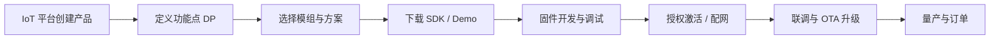
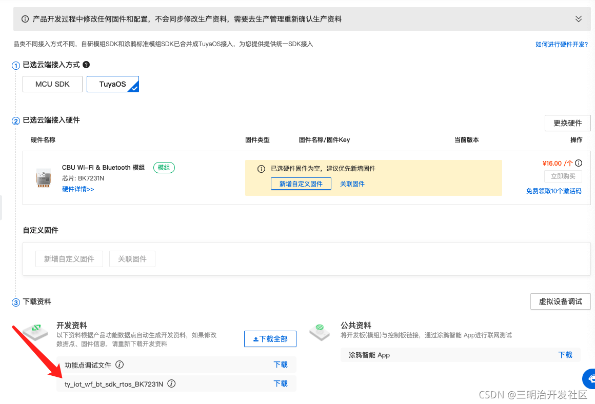
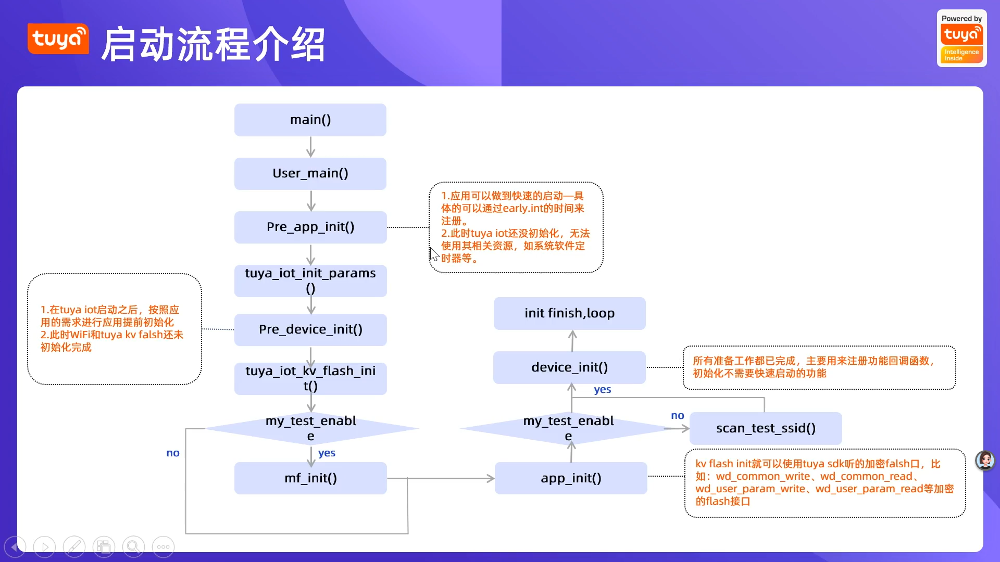

# 涂鸦智能模组 SDK 开发

涂鸦智能（Tuya Smart）是全球化的 IoT 云平台，覆盖 3000+ 品类智能设备。本文整理涂鸦面向 AI + IoT 开发者推出的工具链与生态资源：AI Agent 技能（tuya-smart-control skill）、开源 CLI、TuyaOpen 跨芯片开发框架、TuyaOpen IDE、Tuya AI Coding、Cobuilder、Wukong AI SDK，以及模组选择要点与开发者活动。

## 开发流程概览



## 选择模组

- **NANO 主控板（BK7231N）**：基于博通集成 BK7231N（2.4 GHz Wi-Fi + BLE SoC），常见于涂鸦 WB2S/CB2S 类模组生态，可用于涂鸦智能模组 SDK（TuyaOS）开发。

> 待补充：NANO 主控板引脚定义、SDK 工程模板、烧录方式等。

## 官方资源速查

### 平台与文档

| 名称 | 地址 | 用途 |
| ---- | ---- | ---- |
| 涂鸦开发者官网 | <https://developer.tuya.com> | 开发文档、SDK 下载、方案资料入口 |
| 涂鸦 IoT 平台 | <https://iot.tuya.com> | 产品创建、PID/DP 定义、设备管理 |
| 涂鸦 PMS 系统 | <https://pms.tuya.com> | 项目管理与订单相关事务 |
| 文档中心 | <https://developer.tuya.com/cn/docs/iot> | IoT 开发文档主体，SDK/协议/接口说明 |
| Demo 中心 | <https://developer.tuya.com/cn/demo> | 官方示例工程与参考实现 |
| 帮助中心 | <https://support.tuya.com/zh/help> | 常见问题、工单与技术支持 |
| 方案中心 | <https://www.tuya.com/cn/developer-stories> | 行业方案与客户案例 |
| Wukong AI 文档 | <https://developer.tuya.com/cn/docs/developer> | Wukong AI SDK 系列开发文档 |

### 工具链与开源项目

| 名称 | 地址 | 用途 |
| ---- | ---- | ---- |
| TuyaOpen 官网 | <https://tuyaopen.ai/zh/> | TuyaOpen 文档与活动入口 |
| TuyaOpen 主仓库 | <https://github.com/tuya/TuyaOpen> | 跨芯片开源开发框架源码（点 Star 可用于领取活动授权码） |
| TuyaOpen IDE 下载 | <https://tuyaopen.ai/tuyaopen-ide> | IDE 安装包下载 |
| tuya-smart-control-cli | <https://github.com/tuya/tuya-smart-control-cli> | 开源命令行工具 |
| TuyaOpen-dev-skills | <https://github.com/tuya/TuyaOpen-dev-skills> | TuyaOpen SDK 专家技能集 |
| Tuya AI Coding | <https://coding.tuya.ai/> | AI Native 无代码应用开发平台 |
| Tuya Cobuilder | <https://www.tuya.com/cobuilder> | AI 硬件零代码 Vibe Coding 平台 |
| DuckyClaw 官网 | <https://tuyaopen.ai/zh/duckyclaw> | DuckyClaw 产品与开发者活动 |
| TuyaClaw 官网 | <https://claw.tuyasmart.com> | TuyaClaw 产品与开发者活动 |

## AI Agent 接入：tuya-smart-control skill

涂鸦上线的 AI Agent 新技能，让 AI Agent（如 OpenClaw「龙虾」）可以直接控制涂鸦生态设备。

### 使用步骤（两步）

1. **获取 skill 的 key**
   - 访问：<https://tuyasmart.com/>
   - 用涂鸦 APP 扫码登录后创建 API key，一键复制配置信息
2. **安装技能并配置**
   - 通过 <https://clawhub.ai/gaosq856/tuya-smart-control> 安装技能
   - 将一键复制的配置信息粘贴到技能配置中即可

## tuya-smart-control-cli（涂鸦 CLI）

涂鸦正式开源的命令行工具，让 AI Agent 一行命令管理 3000+ 品类智能设备。  
GitHub：<https://github.com/tuya/tuya-smart-control-cli>  
新特性：在原基础上支持了 IPC 设备的快照和录像功能。

### Enduser API 与 CLI 的关系

- Tuya Enduser API 是涂鸦开放给开发者的官方接口（底层能力）
- tuya-smart-control-cli 是基于上述 Enduser API 封装的开箱即用命令行工具

### AI+IoT 开发者为什么需要 CLI

1. 设备调试效率大幅提升
2. 批量操作无需开发管理后台
3. 为 AI Agent 提供设备操作入口
4. 支持 JSON 输出，便于数据处理与集成

5 分钟即可完成配置，详见仓库文档。

## TuyaOpen 开发框架

TuyaOpen 是涂鸦的开源跨平台开发框架，支持多芯片/硬件快速构建联网 AI 设备。主仓库：<https://github.com/tuya/TuyaOpen>。

### TuyaOpen x ESP32

在 ESP32 开发板上构建、烧录并运行第一个 TuyaOpen 应用。  
详情：<https://tuyaopen.ai/zh/docs/hardware-specific/espressif/esp32-quick-start>

**准备环境**

- ESP32 开发板（ESP32、ESP32-S3、ESP32-C3 或 ESP32-C6）
- USB 数据线（USB-C 或 Micro-USB，取决于开发板）
- 运行 Linux、macOS 或 Windows 的电脑
- Wi-Fi 网络（2.4 GHz）

**步骤**

1. 克隆 TuyaOpen 并配置环境
2. 选择要构建的项目
3. 选择 ESP32 开发板配置
4. 构建固件
5. 烧录固件
6. 查看设备日志
7. 设备配网

### TuyaOpen x T5AI

T5AI 板级资料：<https://tuyaopen.ai/zh/docs/hardware-specific/tuya-t5/t5-ai-board/overview-t5-ai-board>

### TuyaOpen x Raspberry Pi

在树莓派上搭建聊天机器人：<https://tuyaopen.ai/zh/docs/hardware-specific/Linux/raspberry-pi/Applications/your-chat-bot-on-raspberry-pi>

## TuyaOpen IDE

全新发布的 IDE，纯自然语言迅速落地硬件实体，大幅提升开发效率。  
下载：<https://tuyaopen.ai/tuyaopen-ide>

### 每月手搓活动

用 TuyaOpen IDE 手搓 Demo，每月前五名获得购物卡奖金 100 元；作品每获得 50 赞，奖金增加 10 元。  
报名链接：<https://jja0khqo.jsjform.com/f/AoucFM>

**提交格式**

1. Demo 视频/图片/文档
2. 上传 TuyaOpen GitHub 链接
3. 发布小红书/视频号

## TuyaOpen SDK 专家技能（VibeCoding）

涂鸦推出的 TuyaOpen SDK 专家技能，沉淀硬件开发最佳实践，面向 VibeCoding 优化：从新建工程、设备认证、编译烧录，到调试与事件注入测试，全程遵循硬件在环（HIL）思路。  
GitHub：<https://github.com/tuya/TuyaOpen-dev-skills>

## Tuya AI Coding

AI Native 无代码应用开发平台，只需自然语言即可用 AI 把想法变成应用。  
网址：<https://coding.tuya.ai/>（可申请免费积分内测）

**核心能力**

1. **对话式编程**：用自然语言描述需求，AI 负责读、写、运行和修复，每一步都可见
2. **云端沙箱**：每个应用在独立云端沙箱中运行，依赖、运行时、预览开箱即用，无需本地配置
3. **一键托管**：一键部署到生产环境，获得可分享的链接，平台托管

**适用场景**

- 设计师/自由职业者/创作者：制作作品集、交互原型、个人小程序
- 创业者：生成可测试原型、集成用户行为数据看板，实现 MVP 验证
- 教师/指导老师：制作互动课件、教学工具、学生项目开发平台

## Tuya Cobuilder

AI 硬件零代码 Vibe Coding 平台。  
网址：<https://www.tuya.com/cobuilder>

**覆盖流程**

1. 产品创建与功能点设计
2. 面板开发
3. 智能体构建
4. 固件开发与编译
5. 授权与烧录

## Wukong AI SDK

TuyaOS Wukong AI SDK 系列文档提供一站式教程，覆盖 SDK 开发、涂鸦开发者平台产品创建、智能体创建等场景。  
文档：<https://developer.tuya.com/cn/docs/developer>  
SDK 商务邮箱申请：zouxk@tuya.com

## 开发者活动与社区

- 官网活动页：<https://tuyaopen.ai/zh/event-registration>
  - **活动内容**：定期更新涂鸦官方最新的开发者黑客松比赛和活动（桌面搭子开发者比赛、开发者贡献活动、DuckyClaw 开发者比赛）
  - **开发者优秀作品 List**：定期更新开发者作品（基于涂鸦 T5 的智能生肖墨水屏、基于涂鸦 T5AI-Board 的墨水屏阅读器、基于涂鸦 T5AI 的开发板移植游戏）
- 开发者贡献活动报名：<https://ourojj8n.jsjform.com/f/R2MC4J>
  - 活动内容：体验 tuya-smart-control skill → 发布到社交媒体并提交链接 → 数据优异者月末可获得现金购物卡奖励

---

整理自涂鸦开发者社群公告（2026-11）。

## 环境搭建

在Linux Ubuntu 中下载编译依赖工具
```bash
sudo apt-get update -y
sudo apt-get upgrade -y
sudo apt-get install net-tools build-essential wget git python3 libc6-i386 -y
```

 GitHub上获取SDK进行验证
```bash
cd /home/share/samba/
git clone https://github.com/tuya/tuya-iotos-embeded-sdk-wifi-ble-bk7231n.git
```
输入下列命令，开始编译 tuya_demo_template：
```bash
cd tuya-iotos-embeded-sdk-wifi-ble-bk7231n/
sh build_app.sh apps/tuya_demo_template/ tuya_demo_template 1.0.0 
```
涂鸦IoT平台下载SDK进行验证


`sh build_app.sh apps/tuya_demo_template tuya_demo_template 1.0.0 #输入该命令将会在所需相关资源下载完成后开始编译`
## 固件编译

文件名	功能
bk7231n_light1_io_xx_QIO_1.0.0.bin	生产区固件：boot+用户区固件+检测固件。
bk7231n_light1_io_xx_UA_1.0.0.bin	用户区固件
bk7231n_light1_io_xx_UG_1.0.0.bin	升级固件 

>自定义开发固件不上传到云平台，直接将UA文件烧录到已授权的模组中，会导致配网一直无法成功。

## 烧录授权

1. PMS账号
2. CBU Nano开发板或涂鸦WiFi模组+usb转UART串口工具
3. 云模组烧录授权工具
4. 原厂烧录工具


T1模组烧录工具是什么，如何接线？
https://support.tuya.com/zh/help/_detail/Kf8k1nr4ggro7

T1系列模块如何擦除授权区域
https://support.tuya.com/zh/help/_detail/Kfqkub3rayqf8

## 代码解析
