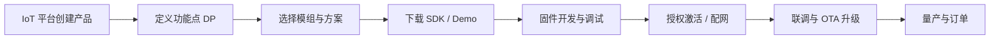
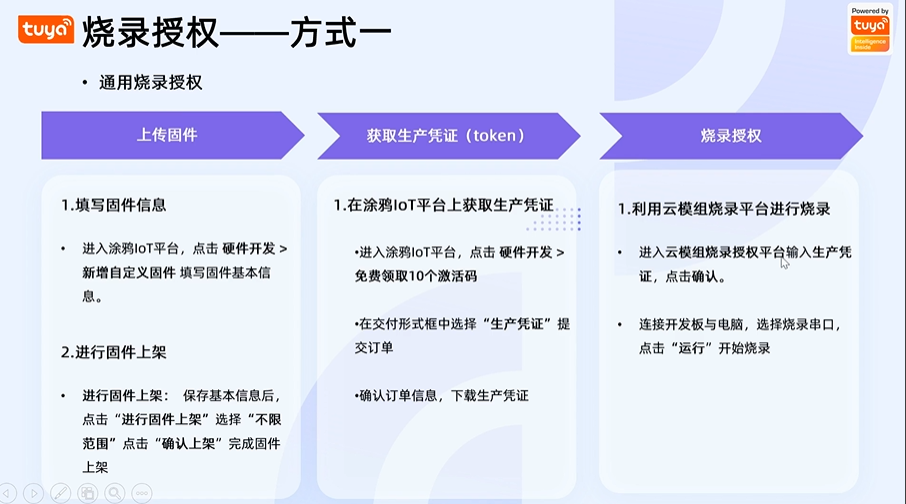
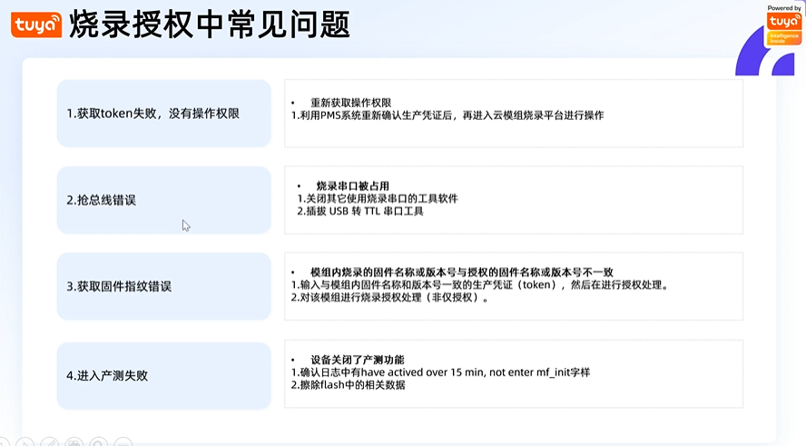
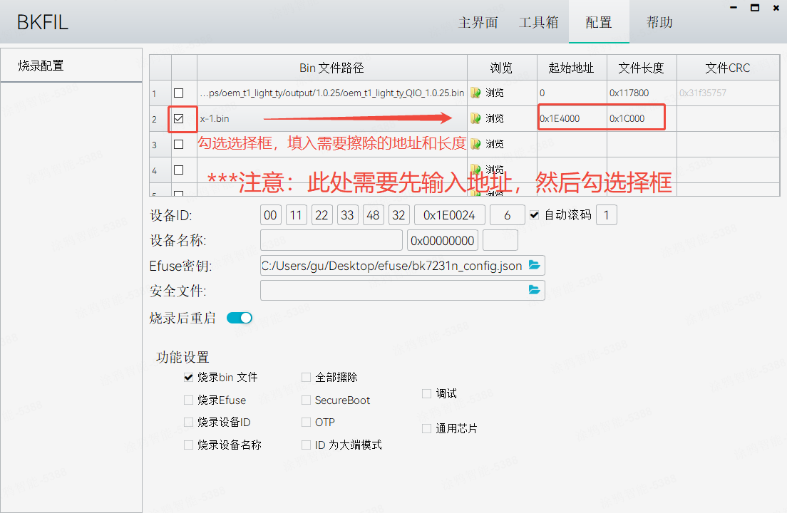
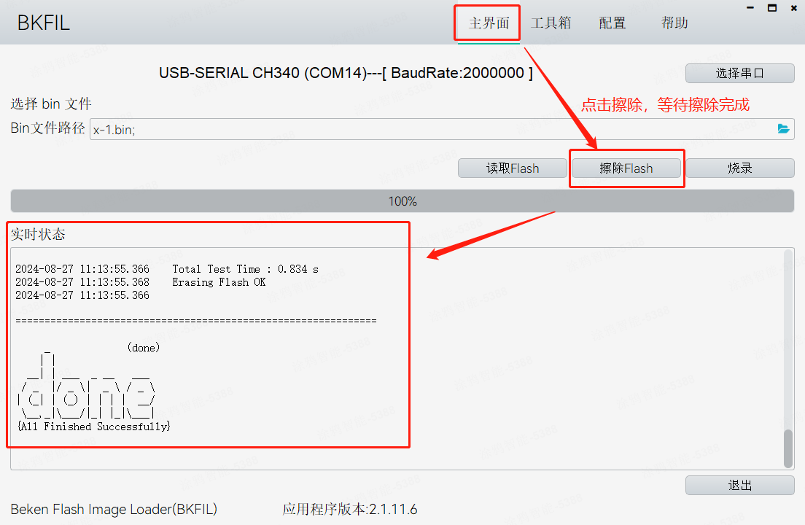
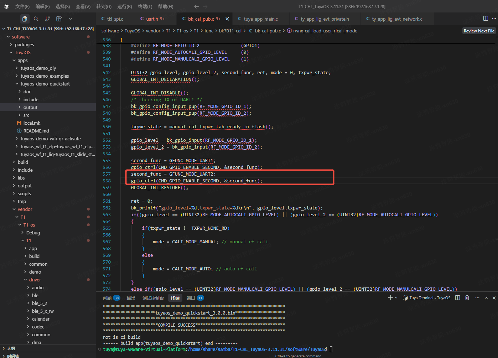
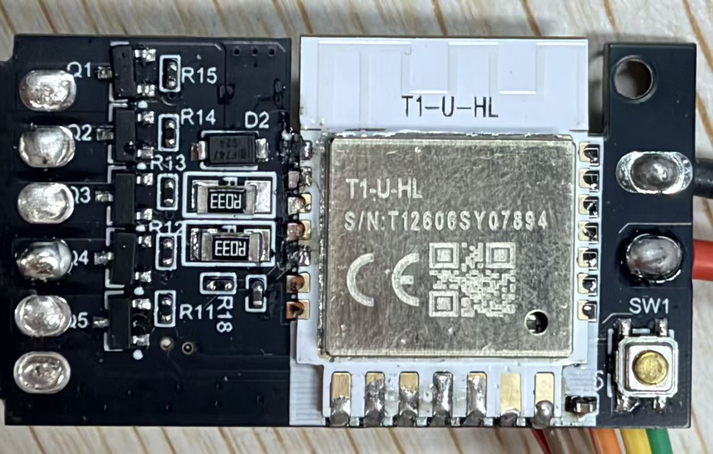

# 涂鸦模组 SDK 开发

## 开发流程概览



## 官方资源速查

### 平台与文档

| 名称 | 地址 | 用途 |
| ---- | ---- | ---- |
| 涂鸦开发者官网 | <https://developer.tuya.com> | 开发文档、SDK 下载、方案资料入口 |
| 涂鸦 IoT 平台 | <https://iot.tuya.com> | 产品创建、PID/DP 定义、设备管理 |
| 涂鸦 PMS 系统 | <https://pms.tuya.com> | 项目管理与订单相关事务 |
| 文档中心 | <https://developer.tuya.com/cn/docs/iot> | IoT 开发文档主体，SDK/协议/接口说明 |
| Demo 中心 | <https://developer.tuya.com/cn/demo> | 官方示例工程与参考实现 |
| 帮助中心 | <https://support.tuya.com/zh/help> | 常见问题、工单与技术支持 |
| 方案中心 | <https://www.tuya.com/cn/developer-stories> | 行业方案与客户案例 |
| Wukong AI 文档 | <https://developer.tuya.com/cn/docs/developer> | Wukong AI SDK 系列开发文档 |

### 工具链与开源项目

| 名称 | 地址 | 用途 |
| ---- | ---- | ---- |
| TuyaOpen 官网 | <https://tuyaopen.ai/zh/> | TuyaOpen 文档与活动入口 |
| TuyaOpen 主仓库 | <https://github.com/tuya/TuyaOpen> | 跨芯片开源开发框架源码（点 Star 可用于领取活动授权码） |
| TuyaOpen IDE 下载 | <https://tuyaopen.ai/tuyaopen-ide> | IDE 安装包下载 |
| tuya-smart-control-cli | <https://github.com/tuya/tuya-smart-control-cli> | 让 AI Agent（如 OpenClaw「龙虾」）可以直接控制涂鸦生态设备 |
| TuyaOpen-dev-skills | <https://github.com/tuya/TuyaOpen-dev-skills> | TuyaOpen SDK 专家技能集 |
| Tuya AI Coding | <https://coding.tuya.ai/> | AI Native 无代码应用开发平台 |
| Tuya Cobuilder | <https://www.tuya.com/cobuilder> | AI 硬件零代码 Vibe Coding 平台 |
| DuckyClaw 官网 | <https://tuyaopen.ai/zh/duckyclaw> | DuckyClaw 产品与开发者活动 |
| TuyaClaw 官网 | <https://claw.tuyasmart.com> | TuyaClaw 产品与开发者活动 |

## 环境搭建与 SDK 编译

### 安装编译依赖（Linux Ubuntu）

```bash
sudo apt-get update -y
sudo apt-get upgrade -y
sudo apt-get install net-tools build-essential wget git python3 libc6-i386 -y
```

### 获取 SDK（两种方式）

**方式一：GitHub 拉取官方 SDK**

```bash
cd /home/share/samba/
git clone https://github.com/tuya/tuya-iotos-embeded-sdk-wifi-ble-bk7231n.git
```

**方式二：涂鸦 IoT 平台下载产品配套 SDK**

在 IoT 平台产品的「硬件开发」页选择 TuyaOS 接入方式与模组（如 CBU，芯片 BK7231N），在「下载资料 → 开发资料」中下载 `ty_iot_wf_bt_sdk_rtos_BK7231N`：


### 编译 Demo

```bash
cd tuya-iotos-embeded-sdk-wifi-ble-bk7231n/
sh build_app.sh apps/tuya_demo_template/ tuya_demo_template 1.0.0
```

> 命令格式：`sh build_app.sh <工程目录> <工程名> <版本号>`。首次执行会先下载所需相关资源（platforms 下的原厂库与工具），下载完成后自动开始编译；产物在工程目录的 `output/` 下按版本号存放。

## 固件编译产物

| 文件（示例） | 类型 | 用途 |
| ---- | ---- | ---- |
| `bk7231n_light1_io_xx_QIO_1.0.0.bin` | 生产固件 | boot + 用户区固件 + 检测固件，量产烧录授权时使用 |
| `bk7231n_light1_io_xx_UA_1.0.0.bin` | 用户区固件 | 本地调试，用原厂烧录工具烧录 |
| `bk7231n_light1_io_xx_UG_1.0.0.bin` | 升级固件 | OTA 升级使用 |

> **注意**：自定义开发固件若不上传到云平台完成烧录授权，直接将 UA 文件烧录到未授权模组中，会导致配网一直无法成功。新模组必须先经过一次「云模组烧录授权」，之后迭代调试才能只用原厂工具烧 UA。

## 烧录授权

### 准备清单

1. PMS 账号（<https://pms.tuya.com>，用于确认生产凭证）
2. CBU Nano 开发板，或涂鸦 WiFi 模组 + USB 转 UART 串口工具
3. 云模组烧录授权工具（量产/首次授权）
4. 原厂烧录工具（开发迭代，如 Beken Writer / BKFIL）

### 烧录接线（USB-TTL ↔ T1 / CBU 模组）

**模组与芯片对应关系**

| 模组 | 芯片 |
| ---- | ---- |
| T1 系列（T1-U、T1-U-HL 等） | BK7238 |
| T5 系列（T5AI 等） | BK7258 |
| CBU | BK7231N |

T1（BK7238）与 CBU（BK7231N）的 UART 引脚定义一致，均有两路 UART：**UART1 为烧录/下载串口，UART2 为日志串口**。接线如下（TX/RX 交叉、GND 共地）：

| USB-TTL 串口工具 | 模组引脚（BK7238 / BK7231N） | 方向 | 说明 |
| ---- | ---- | ---- | ---- |
| TX | P10（UART1_RXD） | 工具 → 模组 | 烧录串口，交叉连接 |
| RX | P11（UART1_TXD） | 模组 → 工具 | 烧录串口，交叉连接 |
| GND | GND | — | 必须共地 |
| 3V3 | 3V3 / VBAT | 工具 → 模组 | 供电 3.0~3.6V；模组独立供电时只接 GND，勿接 5V |
| RX（第二路，可选） | P00（UART2_TXD） | 模组 → 工具 | 日志串口输出 |
| TX（第二路，可选） | P01（UART2_RXD） | 工具 → 模组 | 日志串口输入，只看日志可不接 |

```text
 USB-TTL 串口工具                T1 / CBU 模组 (BK7238 / BK7231N)
 ───────────────                ────────────────────────
 TX  ────────────────────────▶  P10 (UART1_RXD)  ┐ 烧录串口
 RX  ◀────────────────────────  P11 (UART1_TXD)  ┘ UART1
 GND ─────────────────────────  GND              共地
 3V3 ─────────────────────────  3V3 (VBAT)       供电 3.0~3.6V

 RX  ◀────────────────────────  P00 (UART2_TXD)  ┐ 日志串口
 TX  ────────────────────────▶  P01 (UART2_RXD)  ┘ UART2 (可选)
```

**接线与进入烧录模式要点**

- 点击烧录工具的「烧录 / 运行」后，需给模组**重新上电或按复位**，模组才会进入下载模式开始握手。
- 三明治 NANO 主控板（BK7231N）板载 USB 转串口芯片（CH342 双串口）：**A 口 = 烧录串口（UART1），B 口 = 日志串口（UART2）**；拨码开关 S1 控制板载串口与模组的通断，外部占用 P10/P11/P00/P01 时需拨断对应链路，避免总线冲突。
- NANO 板授权阶段若报「获取 RF 标志位失败」：将串口 2 的 RXD（P01）与 GND 短接后再授权。
- 参考文档：
  - T1 模组烧录工具与接线：<https://support.tuya.com/zh/help/_detail/Kf8k1nr4ggro7>
  - 原厂烧录工具使用（调试阶段）：<https://doc.weixin.qq.com/doc/w3_AbQAqAb1AFU41R4BBwQTNmfpgGlVZ?scode=AGQAugfWAAkfaF6FeVAeUAWwZuAAg>
  - 云模组烧录授权（量产阶段）：<https://developer.tuya.com/cn/docs/iot/flash-and-authorize?id=Kaytfatwdbfj2>

### 烧录授权方式

**方式一：通用烧录授权（首次/量产必走）**



1. **上传固件**：IoT 平台「硬件开发 → 新增自定义固件」填写固件信息并上架（选择「不限范围」确认上架）。
2. **获取生产凭证（token）**：IoT 平台「硬件开发 → 免费领取 10 个激活码」，交付形式选择「生产凭证」提交订单，确认后下载生产凭证。
3. **烧录授权**：云模组烧录授权平台输入生产凭证并确认，连接开发板与电脑、选择烧录串口，点击「运行」开始烧录（期间按提示复位模组）。

**方式三：仅烧录（开发过程中常用）**


- 使用原厂工具（Beken Writer）只烧录 **UA 用户区固件**，**不能授权**。
- 仅适用于**已经授权过**的模组，避免每次改代码都要上传云平台走「云模组烧录授权」。
- 烧录时固件标识名/版本号需与模组内已授权固件一致，否则报指纹错误（见下表）。

### 烧录授权常见问题



| 问题 | 原因 | 处理 |
| ---- | ---- | ---- |
| 获取 token 失败，没有操作权限 | 生产凭证未确认 | 利用 PMS 系统重新确认生产凭证后，再进云模组烧录平台操作 |
| 抢总线错误 | 烧录串口被占用 | 关闭其它占用烧录串口的工具软件；插拔 USB 转 TTL 串口工具 |
| 获取固件指纹错误 | 模组内固件名称/版本号与授权凭证不一致 | 输入与模组内固件名称、版本一致的生产凭证再授权；或对该模组重新「烧录授权」（而非仅授权） |
| 进入产测失败 | 设备关闭了产测功能 | 确认日志中有 `have actived over 15 min, not enter mf_init` 字样；擦除 flash 中的相关数据 |

### T1 系列擦除授权区域

工具：BK 原厂 **BKFIL**（`BEKEN_BKFIL_V2.1.11.6_20240417.zip`），接线同上表烧录串口。

1. **配置页**：勾选第 2 行 bin 文件，填入起始地址 `0x1E4000`、文件长度 `0x1C000`。**注意先输入地址和长度，再勾选选择框**。
2. **主界面**：选择串口与波特率（如 2000000），点击「擦除 Flash」，等待实时状态出现 `Erasing Flash OK` / `(done)`。





官方说明：<https://support.tuya.com/zh/help/_detail/Kfqkub3rayqf8>

## SDK 启动流程解析


| 阶段 | 说明 |
| ---- | ---- |
| `main()` → `user_main()` | 系统入口进入应用 |
| `pre_app_init()` | 应用提前初始化，可通过 early.int 注册时间实现快速启动；此时 tuya iot 尚未初始化，**不能使用系统软件定时器等相关资源** |
| `tuya_iot_init_params()` → `pre_device_init()` | tuya iot 启动后按应用需求做设备提前初始化；此时 WiFi 与 tuya kv flash 还未初始化完成 |
| `tuya_iot_kv_flash_init()` | 完成后即可使用 SDK 加密 flash 接口：`wd_common_write/read`、`wd_user_param_write/read` 等 |
| `my_test_enable` 判断 → `mf_init()` | 产测使能时进入产测初始化，否则跳过 |
| `app_init()` → `device_init()` | 所有准备工作完成，主要注册功能回调函数、初始化不需要快速启动的功能 |
| 二次 `my_test_enable` 判断 | 非产测模式走 `scan_test_ssid()` 扫描产测路由；否则 init finish 进入 loop |

## TuyaOpen 开发框架

TuyaOpen 是涂鸦的开源跨平台开发框架，支持多芯片/硬件快速构建联网 AI 设备。主仓库：<https://github.com/tuya/TuyaOpen>。

### TuyaOpen x ESP32

在 ESP32 开发板上构建、烧录并运行第一个 TuyaOpen 应用。  
详情：<https://tuyaopen.ai/zh/docs/hardware-specific/espressif/esp32-quick-start>

### TuyaOpen x T5AI

T5AI 板级资料：<https://tuyaopen.ai/zh/docs/hardware-specific/tuya-t5/t5-ai-board/overview-t5-ai-board>

### TuyaOpen x Raspberry Pi

在树莓派上搭建聊天机器人：<https://tuyaopen.ai/zh/docs/hardware-specific/Linux/raspberry-pi/Applications/your-chat-bot-on-raspberry-pi>

## TuyaOpen IDE

全新发布的 IDE，纯自然语言迅速落地硬件实体，大幅提升开发效率。  
下载：<https://tuyaopen.ai/tuyaopen-ide>

### 每月手搓活动

用 TuyaOpen IDE 手搓 Demo，每月前五名获得购物卡奖金 100 元；作品每获得 50 赞，奖金增加 10 元。  
报名链接：<https://jja0khqo.jsjform.com/f/AoucFM>

**提交格式**

1. Demo 视频/图片/文档
2. 上传 TuyaOpen GitHub 链接
3. 发布小红书/视频号

## TuyaOpen SDK 专家技能（VibeCoding）

涂鸦推出的 TuyaOpen SDK 专家技能，沉淀硬件开发最佳实践，面向 VibeCoding 优化：从新建工程、设备认证、编译烧录，到调试与事件注入测试，全程遵循硬件在环（HIL）思路。  
GitHub：<https://github.com/tuya/TuyaOpen-dev-skills>

## AI Agent 接入：Tuya Smart Control CLI

涂鸦上线的 AI Agent 新技能，让 AI Agent（如 OpenClaw「龙虾」）可以直接控制涂鸦生态设备。

### 使用步骤（两步）

1. **获取 skill 的 key**
   - 访问：<https://tuyasmart.com/>
   - 用涂鸦 APP 扫码登录后创建 API key，一键复制配置信息
2. **安装技能并配置**
   - 通过 <https://clawhub.ai/gaosq856/tuya-smart-control> 安装技能
   - 将一键复制的配置信息粘贴到技能配置中即可

### Enduser API 与 CLI 的关系

- Tuya Enduser API 是涂鸦开放给开发者的官方接口（底层能力）
- tuya-smart-control-cli 是基于上述 Enduser API 封装的开箱即用命令行工具

### AI+IoT 开发者为什么需要 CLI

1. 设备调试效率大幅提升
2. 批量操作无需开发管理后台
3. 为 AI Agent 提供设备操作入口
4. 支持 JSON 输出，便于数据处理与集成

## Tuya AI Coding

AI Native 无代码应用开发平台，只需自然语言即可用 AI 把想法变成应用。  
网址：<https://coding.tuya.ai/>（可申请免费积分内测）

**核心能力**

1. **对话式编程**：用自然语言描述需求，AI 负责读、写、运行和修复，每一步都可见
2. **云端沙箱**：每个应用在独立云端沙箱中运行，依赖、运行时、预览开箱即用，无需本地配置
3. **一键托管**：一键部署到生产环境，获得可分享的链接，平台托管

**适用场景**

- 设计师/自由职业者/创作者：制作作品集、交互原型、个人小程序
- 创业者：生成可测试原型、集成用户行为数据看板，实现 MVP 验证
- 教师/指导老师：制作互动课件、教学工具、学生项目开发平台

## Tuya Cobuilder

AI 硬件零代码 Vibe Coding 平台。  
网址：<https://www.tuya.com/cobuilder>

**覆盖流程**

1. 产品创建与功能点设计
2. 面板开发
3. 智能体构建
4. 固件开发与编译
5. 授权与烧录

## Wukong AI SDK

TuyaOS Wukong AI SDK 系列文档提供一站式教程，覆盖 SDK 开发、涂鸦开发者平台产品创建、智能体创建等场景。  
文档：<https://developer.tuya.com/cn/docs/developer>  
SDK 商务邮箱申请：zouxk@tuya.com

## 开发者活动与社区

- **开发者优秀作品 List**：定期更新开发者作品（基于涂鸦 T5 的智能生肖墨水屏、基于涂鸦 T5AI-Board 的墨水屏阅读器、基于涂鸦 T5AI 的开发板移植游戏）
- 开发者贡献活动报名：<https://ourojj8n.jsjform.com/f/R2MC4J>
  - 活动内容：体验 tuya-smart-control skill → 发布到社交媒体并提交链接 → 数据优异者月末可获得现金购物卡奖励

## T1 调试技巧

### 日志串口波特率改为 2M

1. 修改 `software/TuyaOS/vendor/T1/T1_os/T1/driver/uart/uart.h`：把 `UART_BAUD_RATE` 改为 `UART_BAUDRATE_2000000`。
2. 在 `software/TuyaOS/vendor/T1/T1_os/T1/func/bk7011_cal/bk_cal_pub.c` 中（RF 校准引脚复用配置处、`GLOBAL_INT_DISABLE()` 之前）添加两行，把校准检测脚复用为 UART2：

```c
second_func = GFUNC_MODE_UART2;
gpio_ctrl(CMD_GPIO_ENABLE_SECOND, &second_func);
```



### 进入 / 退出 RTOS 临界区

调用 `rtos_enter_critical()` 进入、`rtos_exit_critical()` 退出，函数位于：

```text
software/TuyaOS/vendor/T1/T1_os/T1/os/FreeRTOSv9.0.0/rtos_pub.c
```

## WSL + usbipd 烧录 TuyaOS 固件

场景：在 VS Code TuyaOS 插件中让 AI 执行烧录，编译在 WSL 内、串口设备挂在 Windows 侧，需通过 usbipd 把 USB 串口透传进 WSL。

### 1. Windows 侧安装 usbipd-win

管理员 PowerShell 执行：

```powershell
winget install --interactive --exact dorssel.usbipd-win
```

装完**重开一个管理员 PowerShell**（让 PATH 生效）。

### 2. 绑定并透传串口设备

```powershell
usbipd list
```

找到 `USB Composite Device (1a86:55d2)`（CH342，即 Windows 下 COM6/COM7 那个设备）。物理位置如 `Port_#0005.Hub_#0001` 对应 busid 大概率是 `1-5`，**以 `usbipd list` 显示为准**：

```powershell
usbipd bind --busid 1-5          # 只需执行一次
usbipd attach --wsl --busid 1-5  # 每次重新插拔/重启后执行
```

### 3. WSL 侧加载 USB/IP 驱动

```bash
sudo modprobe vhci-hcd
ls -l /dev/ttyUSB*
```

应能看到 `/dev/ttyUSB0` 和 `/dev/ttyUSB1`（CH342 的 A/B 两路，分别对应烧录串口与日志串口）。

### 4. 烧录固件

下载并安装 `tyutool_cli`，烧录 `tuyaos_demo_quickstart_QIO_1.0.0.bin`，关键参数：`-d t1`（芯片型号）、`-b 921600`（烧录波特率）。

## T1开发板+GX8006语音板 

[T1-AI-Voice-BaseBoard_V1.0.1](./T1-AI-Voice-BaseBoard_V1.0.1.pdf) + [GX8006-Voice-board_V1.0.0](./GX8006-Voice-board_V1.0.0.pdf)

### 引脚定义

| 信号 | 引脚 |
| ---- | ---- |
| NET_KEY | P23 |
| AWK_KEY | P22 |
| R_LED | P24 |
| G_LED | P9 |
| B_LED | P26 |
| BLUE_LED | P21 |

## 灯带控制器PCBA分析

### 接线总览

| 硬件 | 模组 | 灯带类型 | 通道引脚 | 配网按键 | IR | MIC |
| ---- | ---- | ---- | ---- | ---- | ---- | ---- |
| 1 | T1-U-HL | 5 路 PWM | G=P8、R=P6、B=P26、C=P24、W=P9 | P14 | — | — |
| 2 | T1-U-HL | 1 路幻彩 + 2 路 PWM | MOSI=P16、C=P6、W=P8 | P22 | P28 | — |
| 3 | T1-U-HL | 1 路幻彩 + 2 路 PWM | MOSI=P16、C=P8、W=P6 | P22 | P28 | ADC（P20） |
| 4 | CBU | 5 路 PWM | G=P7、R=P6、B=P8、C=P9（存疑）、W=P26 | P14 | — | — |
| 5（暂定） | T1-U-HL | 5 路 PWM + SPI 幻彩 | R=P6、G=P8、B=P9、CW=P24、WW=P26；MOSI=P16、CLK=P14 | P22 | P28（预留） | ADC（P20） |

### 硬件 1：T1-U-HL 驱动 5 路 PWM 灯带

| 丝印通道 | 模组 GPIO | 外部灯带线（实际焊接） |
| ---- | ---- | ---- |
| G | P8 | R |
| R | P6 | G |
| B | P26 | B |
| C | P24 | WW |
| W | P9 | CW |
| 重置/配网按键 | P14 | — |



> 外部灯带线序 R G B WW CW 依次焊在板载丝印 G R B C W 上：即灯带的 R 线实际由固件 G 通道（P8）驱动，WW 线由 C 通道（P24）驱动，以此类推。

### 硬件 2：T1-U-HL 驱动 1 路幻彩 + 2 路 PWM 灯带

| 功能 | 模组 GPIO | 说明 |
| ---- | ---- | ---- |
| 幻彩灯带数据（MOSI） | P16 | SPI MOSI 接幻彩灯带 DIN |
| PWM 通道 C | P6 | 经板载 MOS 管驱动灯带负极 |
| PWM 通道 W | P8 | 经板载 MOS 管驱动灯带负极 |
| 重置/配网按键 | P22 | 板载 SW1 |
| IR 红外接收 | P28 | — |


> 板载电源丝印 DC5-24V：灯带公共正极接电源+，各通道负极经 MOS 管（Q1~Q3）回模组 GPIO；幻彩灯带需与板子共地。

### 硬件 3：T1-U-HL 驱动 1 路幻彩 + 2 路 PWM 灯带（带 MIC）

| 功能 | 模组 GPIO | 说明 |
| ---- | ---- | ---- |
| 幻彩灯带数据（MOSI） | P16 | SPI MOSI 接幻彩灯带 DIN |
| PWM 通道 C | P8 | 与硬件 2 的 C/W 引脚互换 |
| PWM 通道 W | P6 | 与硬件 2 的 C/W 引脚互换 |
| 重置/配网按键 | P22 | 板载 SW1 |
| IR 红外接收 | P28 | — |
| MIC 拾音 | ADC | 模拟采集 |


### 硬件 4：CBU 驱动 5 路 PWM 灯带

| 丝印通道 | 模组 GPIO | 外部灯带线（实际焊接） |
| ---- | ---- | ---- |
| G | P7 | R |
| R | P6 | G |
| B | P8 | B |
| C | P9（存疑） | WW |
| W | P26 | CW |
| 重置/配网按键 | P14 | — |


> **存疑点**：C 通道实测为 P9，理论应为 P24，以实测为准并留待复核。外部灯带线序与丝印的对应关系同硬件 1（R G B WW CW ↔ G R B C W）。

### 硬件 5（暂定）：T1-U-HL 新产品 PCB 引脚定义

5 路 PWM（R/G/B/CW/WW）+ SPI 幻彩 + MIC 拾音，IR 与 DMX512 预留。

| 功能 | 模组 GPIO | 说明 |
| ---- | ---- | ---- |
| PWM R | P6 | 红 |
| PWM G | P8 | 绿 |
| PWM B | P9 | 蓝 |
| PWM CW | P24 | 冷白 |
| PWM WW | P26 | 暖白 |
| SPI 数据（MOSI） | P16 | 幻彩灯带 DIN（WS2812） |
| SPI 时钟（CLK） | P14 | 幻彩灯带CLK |
| 重置/配网按键 | P22 | |
| IR 红外接收 | P28 | 预留 |
| MIC 拾音 | ADC（P20） | 模拟采集 |
| 低功耗控制开关 | P21 | 控制外部电源开关：低电平导通供电、高电平关断 |
| 烧录串口 UART1（兼 DMX512 预留） | TX1=P11、RX1=P10、CEN(RST) | 烧录下载口，DMX512 预留复用 |
| 日志串口 UART2 | TX2=P0、RX2=P1 | 日志输出 |


### 接线通用说明

- **PWM 灯带**：模组 GPIO → 板载 MOS 管 → 灯带通道负极；灯带公共正极接电源+（板支持 DC5~24V）。
- **幻彩灯带**：数据线 DIN → 模组 SPI MOSI（P16），灯带电源与板子必须共地。
- **丝印 ≠ 灯带线标**：硬件 1/4 调试颜色时以「模组 GPIO」列为唯一依据，不要按灯带线标猜通道。

## 幻彩灯带产品功能定义


### 产品定位

一款使用 T1 Wi-Fi/BLE SoC、200 颗 WS2812 灯珠、GRB 线序、支持 RGB+CW 五路颜色的幻彩灯带；支持 AP 配网、BLE 遥控、在线/本地音乐律动、本地场景、涂抹、灯带裁剪、倒计时、助眠、唤醒、组播和产测。

| 分类 | 当前定义 |
| ---- | ---- |
| 产品类型 | 幻彩灯带（`slide_strip_light` ） |
| 产品 PID | `usb1rqk5gncv3oth` |
| 设备形态 | 单 SoC，无外部 MCU |
| Wi-Fi 配网 | 仅 AP 配网（`TY_WIFI_START_MODE=0`） |
| BLE | 已启用，支持数据处理与遥控 |
| 灯珠 | 200 颗 WS2812，SPI0 驱动，RGB 线序 GRB、CW 线序 CW |
| 颜色通道 | R、G、B、冷白、暖白 |
| 默认状态 | 冷白 / 亮度 100% / 色温 100% |
| OTA 保持亮灯 / Matter / OEM | 均未启用 |

### 灯珠与硬件驱动

| 参数 | 配置项 | 当前值 |
| ---- | ---- | ---- |
| 总灯珠数 | `PIXEL_TOTAL_NUM` | 200 |
| 驱动型号 | `PIXELS_CHIP` | 0 = WS2812 |
| SPI 编号 | `PIXELS_CHIP_SPI_NUM` | SPI0 |
| RGB 线序 | `PIXELS_RGB_LINE_SEQUENCE` | 2 = GRB |
| CW 线序 | `PIXELS_CW_LINE_SEQUENCE` | 0 = CW |
| 总电源控制脚 | `LIGHT_CTRL_PIN` / `LIGHT_CTRL_PIN_LEVEL` | GPIO9 / 低电平开启 |


### 灯光核心与默认参数

- 幻彩像素模式（`LIGHT_PRRODUCT_PIXELS`）、断电记忆、冷暖混光（`ENABLE_COLOR_TEMPER_MIX`）、彩光功率限制均启用；普通全彩/白光彩光共存/本地 Schema 关闭。颜色分辨率 1000。
- 默认：冷白、亮度 100%、色温 100%；彩光/白光亮度下限 10%、上限 100%；渐变间隔 4 ms，开关渐变 800 ms。
- Gamma 与白平衡（修正低亮度平滑与混白偏差）：Gamma R/G/B = 80/60/60；白平衡 R/G/B = 100/70/75。
- 参数存储 NVS 起始 `0x1F1000`、结束 `0x1F4000`，存储延迟 5 秒；NVS 与 OTA Keep 等 Flash 区地址不得重叠。

### DP 映射

> 必须与云平台产品模型保持一致。

| 功能 | DP | 功能 | DP |
| ---- | ---- | ---- | ---- |
| 总开关 | 20 | 灯带总灯珠数 | 47 |
| 灯光模式 | 21 | 灯带总长度 | 46 |
| 在线音乐 | 27 | 灯带裁剪 | 53 |
| 本地音乐 | 52 | 开关渐变时间 | 35 |
| 本地场景 | 51 | 上电勿扰 | 34 |
| 涂抹 | 61 | 动态启动显示 | 33 |
| 直接彩光控制 | 24 | RGB 线序 | 77 |
| 联动颜色 | 28 | 倒计时 | 26 |
| 联动颜色 Pro | 195 | 助眠 | 31 |
| 组播开关状态 | 196 | 唤醒 | 32 |

未启用 DP：直接白光亮度/色温、Matter HS/Level/色温、生物节律/随机/循环定时、独立夜灯/按键/红外/FFC/分段调光。

### 功能模块

| 模块 | 状态 | 关键配置 |
| ---- | ---- | ---- |
| 音乐律动 | 启用 | 在线 DP27、本地麦克风 DP52；ADC0，`LIGHT_ADC_PIN=23`，量程 2400mV，有效阈值 4%~12%，产测 33% |
| 本地场景 | 启用 | DP51，段数 1，启用本地场景库，速度倍率 1（1-10），不支持白光 |
| 涂抹 | 启用 | DP61，最大 20 段，单步亮度 20%；直接彩光控制 DP24/28/195；直接白光关闭；RGB+C+W 五路涂抹关闭（按 RGB 处理） |
| 灯带裁剪 | 启用 | `ENABLE_LIGHT_CLIP=y`，默认长度 200cm；总灯珠 DP47、长度 DP46、裁剪 DP53 |
| BLE | 启用 | 总开关/数据处理/遥控器开启，扫描 60s；BLE 广播、免打扰配网关闭 |
| 定时 | 部分 | 倒计时 DP26、助眠 DP31、唤醒 DP32 启用；生物节律/随机/循环关闭 |
| 组播 | 启用 | `ENABLE_LIGHT_MCAST=y`，开关状态 DP196 |

### 配网、网络通道与产测

- **通道优先级**（启用，值 1）：`BLE > LAN > MQTT`。
- **配网指示**：启用，闪烁/慢速，颜色红色、亮度 50%，最大提醒 606s、正常提醒 180s，停止后恢复默认颜色。
- **产测**：成品功能产测、重复进入经典产测、老化测试（彩/白/暖各 20 分钟）启用；吸顶灯红外产测、上位机成品产测关闭；扫描 App 指定 Wi-Fi 作为成品产测入口。
- **上下电恢复出厂**：启用，连续上电 3 次触发。

### 配置生效流程

1. 在 IDE「应用配置」中修改功能；2. 核对硬件项与原理图/BOM/灯珠规格书一致；3. 保存更新 `build/tuya_app.config`；4. IDE 自动生成 `include/tuya_app_config.h`；5. 重新编译；6. 检查 UA/UG 固件；7. 烧录后验证灯光、DP、配网、BLE、音乐、场景、产测与上下电重置。

> 不要直接修改自动生成的 `include/tuya_app_config.h`。


