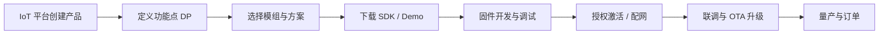

# 涂鸦智能模组 SDK 开发

## 常用链接

| 名称 | 地址 | 用途 |
| ---- | ---- | ---- |
| 涂鸦开发者官网 | https://developer.tuya.com | 开发文档、SDK 下载、方案资料入口 |
| 涂鸦 IoT 平台 | https://iot.tuya.com | 产品创建、PID/DP 定义、设备管理 |
| 涂鸦 PMS 系统 | https://pms.tuya.com | 项目管理与订单相关事务 |
| 文档中心 | https://developer.tuya.com/cn/docs/iot | IoT 开发文档主体，SDK/协议/接口说明 |
| Demo 中心 | https://developer.tuya.com/cn/demo | 官方示例工程与参考实现 |
| 帮助中心 | https://support.tuya.com/zh/help | 常见问题、工单与技术支持 |
| 方案中心 | https://www.tuya.com/cn/developer-stories | 行业方案与客户案例 |

## 开发流程概览

（待补充）

## 模组与方案选型

（待补充）

## 开发环境搭建

（待补充）

## 功能点（DP）定义

（待补充）

## 配网与激活授权

（待补充）

## MCU 串口对接协议

（待补充）

## OTA 固件升级

（待补充）

## 调试与日志

（待补充）
